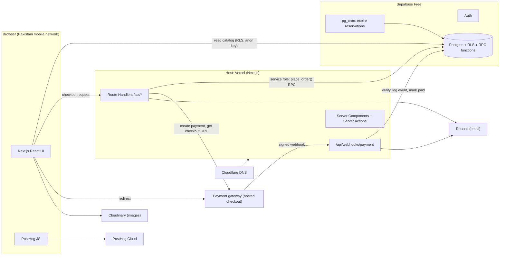

# Mythos — Architecture (Proposed)

> **Status:** proposal for discussion. Nothing here is built yet. This document explains the
> diagram below and records the trade-offs, risks, and decisions that must be settled **before**
> scaffolding the app.

## The diagram



## In one paragraph

A **Next.js app on Vercel** serves the storefront. Buyers read the product catalog **directly from
Supabase** using the public anon key and Row Level Security, so browse traffic never touches the
Next.js server. Anything that touches money — creating an order, calling the payment gateway,
handling webhooks, expiring stale reservations — runs **server-side** with the Supabase service-role
key. The payment gateway is a **hosted checkout**, so card/wallet details never enter the app.
Supabase Postgres is the single source of truth; Auth, RLS policies and `SECURITY DEFINER` RPC
functions enforce the rules inside the database. Resend handles email, Cloudinary handles images,
PostHog handles analytics, and Cloudflare provides DNS. A `pg_cron` job inside Postgres releases
stock held by unpaid reservations.

## Components and responsibilities

| Component | Runs where | Responsibility | Trust level |
|---|---|---|---|
| **Next.js React UI** | Browser | Storefront, cart, checkout form, redirect to gateway | Untrusted |
| **Server Components / Actions** | Vercel Functions (Node runtime) | Render pages, call privileged APIs, hide secrets | Privileged |
| **Route Handlers `/api/*`** | Vercel Functions (Node runtime) | Checkout orchestration, order lookup, webhook endpoint | Privileged |
| **`/api/webhooks/payment`** | Vercel Functions | Verify signature, persist event, transition order state | Privileged, unauthenticated endpoint |
| **`pg_cron` job** | Supabase Postgres | Release stock for expired unpaid reservations | Privileged |
| **Supabase Auth** | Supabase | Customer identity, sessions, JWT issuance | Managed |
| **Postgres + RLS + RPC** | Supabase | All state: products, stock, orders, payments, events | **Source of truth** |
| **Payment gateway** | Third party | Hosted checkout page, payment confirmation, signed webhooks | External |
| **Resend** | Third party | Order confirmation, receipts, failure notices | External |
| **Cloudinary** | Third party | Product image storage and CDN delivery | External |
| **PostHog** | Third party | Product analytics and funnels | External |
| **Cloudflare DNS** | Third party | DNS records for the Vercel domain (proxy **off** unless deliberately configured) | Infrastructure |

## How a request moves

### 1. Browsing the catalog (no server hop)

```
Browser → Supabase PostgREST (anon key) → RLS policy "public can read published products"
```

Public tables are read-only to `anon`; everything else is denied by default. Because this traffic
never hits Vercel, it does not consume function invocations. The cost is that catalog reads are as
fast as the browser↔Supabase path — choose the Supabase region accordingly (see risks).

### 2. Placing an order

```
UI → POST /api/checkout → place_order() RPC (service role, one transaction)
                          ├─ verify variant + price server-side
                          ├─ reserve stock (row lock, no oversell)
                          ├─ insert order + order_items (status = pending)
                          └─ insert reservation (expires_at = now() + N minutes)
   → create payment with gateway → return checkout URL
UI → redirect to gateway
```

`place_order()` is a single SQL transaction: either the stock is reserved and the order exists, or
nothing changed. The client never sends prices or totals that the server trusts — the RPC reads them
from the `variants` table. An **idempotency key** from the client prevents duplicate orders when a
user double-taps on a slow connection.

### 3. Paying

```
Gateway hosted page → user pays → gateway redirects browser to /checkout/return
                                → gateway POSTs signed webhook to /api/webhooks/payment
```

The redirect is **cosmetic** — it only tells the UI to show "processing". The webhook is the only
event that may mark an order paid.

### 4. Webhook processing

```
verify signature (raw body) → insert into webhook_events (unique provider_event_id)
  → if new: transition order pending → paid inside a transaction
  → if duplicate: return 200 immediately (idempotent)
  → respond 2xx fast → send receipt via Resend (after response)
```

Webhooks retry and can arrive out of order, so the handler must be idempotent and must reject
illegal state transitions (e.g. `paid → paid`, `cancelled → paid`). Every delivery is kept in
`webhook_events`, which doubles as an audit log.

### 5. Reservation expiry

```
Supabase pg_cron (e.g. every 5 min) → expire_reservations() SQL function
  → orders still pending past expires_at: mark expired, restore stock
```

This runs **inside Postgres**, not on Vercel: Vercel Hobby cron jobs are limited to once per day,
which is far too coarse for reservations. `pg_cron` also removes a host dependency — expiry keeps
working even during a deploy.

Defensive design: availability queries also treat `expires_at < now()` as unavailable, so a late or
failed cron run can never cause overselling — the cron is cleanup, not a correctness dependency.

## Why this shape

**Reads go direct, writes go through the server.** Catalog traffic is the volume; routing it around
Next.js keeps function invocations low and pages fast. Mutations involve money and secrets, so they
belong on the privileged side.

**The database enforces invariants.** Stock reservation, order totals, and payment state transitions
live in SQL transactions with constraints and `SECURITY DEFINER` functions. Application code can be
wrong or retried; the database cannot oversell if the lock is correct.

**Hosted checkout removes the worst security surface.** No card numbers, no PCI scope beyond SAQ A,
no custom 3-D Secure flow. The gateway owns the payment page; we own the webhook.

**Server-side secrets stay server-side.** The service-role key, gateway secret, Resend key and
webhook signing secret exist only in Vercel environment variables. The browser gets exactly one
credential: the Supabase anon key, which is designed to be public and is constrained by RLS.

## Trust boundaries

| Boundary | Who may cross | Control |
|---|---|---|
| Browser → Supabase | Anyone with the anon key | RLS on **every** table; default deny; public read only on catalog views |
| Browser → `/api/*` | Anyone | Rate limiting, validation, auth checks where needed |
| Gateway → `/api/webhooks/payment` | Gateway | HMAC signature over the **raw** request body; timestamp tolerance |
| Vercel → Supabase (privileged) | Server only | `service_role` key in env vars; never in client bundles |
| Browser → Cloudinary | Anyone (read) | Signed uploads for admin; no unsigned upload presets |
| Browser → PostHog | Anyone | Reverse proxy via `/ingest` to survive ad blockers; no PII |

> **Rule:** a table without RLS enabled is a public table. Treat "RLS enabled" as part of the
> definition of done for every migration.

## Free-tier envelope (verify current limits before committing)

| Service | Free tier (approximate) | What it means here |
|---|---|---|
| Vercel | Hobby: ~100 GB fast data transfer, ~1M edge requests, capped function CPU/duration; cron limited to once per day | **Hobby is for non-commercial use** — upgrade to Pro before taking real orders |
| Supabase | ~500 MB DB, ~1 GB storage, ~50k MAU | Project **pauses after ~1 week of inactivity** — bad for a quiet store |
| Cloudflare DNS | Free, unlimited | DNS only unless you deliberately enable the proxy |
| Resend | ~3,000 emails/mo, ~100/day | Enough for launch; watch retries and duplicate sends |
| Cloudinary | ~25 credits/mo | Image transformations consume credits; cap sizes |
| PostHog | ~1M events/mo | Generous, but autocapture on mobile can burn it |

> **Plan for the upgrade.** The scaffold and internal demo can run on Vercel Hobby, but a store that
> sells is commercial use. Budget for **Vercel Pro** (and paid Supabase if the pause is unacceptable)
> before launch — not after the first traffic spike.

## Risks and sharp edges

| Risk | Why it matters | Mitigation |
|---|---|---|
| **Vercel Hobby cron is daily** | Minute-level reservation expiry cannot run on Hobby cron | Run expiry in Supabase `pg_cron` (already the design); Vercel cron is not on the critical path |
| **Vercel Hobby is non-commercial** | Selling on a Hobby project breaches its terms and the limits are low | Upgrade to Pro before launch; Hobby is fine for the scaffold and demo |
| **Function region and cold starts** | Hobby functions may run far from Pakistan, and the first request after idle is slow | Keep catalog reads on the direct Supabase path; choose a region on Pro; keep functions small |
| **Supabase free project pause** | Store silently goes read-only/offline after inactivity | Uptime ping, or accept and document; upgrade before real traffic |
| **Webhook endpoint is public** | Unverified events could mark orders paid | Signature verification, unique event IDs, state-machine checks, timestamp window |
| **Out-of-order / duplicate webhooks** | Refunds and retries can replay events | Idempotent handler + `webhook_events` table + legal-transition guard |
| **Stock races** | Two buyers, last item | `SELECT … FOR UPDATE` inside `place_order()`, check-then-decrement in one transaction |
| **Money as floats** | Rounding errors in PKR | Integer minor units (`bigint` paisa) everywhere |
| **Unsigned Cloudinary uploads** | Anyone can fill your media account | Signed uploads, server-generated signatures, upload presets locked down |
| **Analytics blocked / heavy** | PostHog JS fails on many Pakistani mobile networks and ad blockers; bundle hurts slow connections | First-party proxy, lazy load, sample events, consent-aware |
| **Single Supabase region** | Pakistan → distant region adds RTT to every query | Choose the closest region (Mumbai `ap-south-1` or Singapore) for the project; direct reads bypass Vercel entirely |
| **Email in the request path** | Resend latency/failure blocks the response | Send after responding (Next.js `after()`), never before the 2xx |
| **Two deploy sources** | Confusion and duplicate deploys | GitHub → Vercel integration only; no `vercel --prod` from a laptop |

## Decisions

**Locked:**

1. **Host: Vercel.** Next.js is Vercel's native framework — zero build configuration, first-class
   App Router, Server Actions, ISR and image optimisation. Hobby for the scaffold; Pro before sales.
2. **Expiry: Supabase `pg_cron`.** Runs inside Postgres at minute granularity, independent of the
   host's cron limits.
3. **Checkout: hosted payment page.** No card data in the app.

**Still to decide:**

1. **Payment gateway.** Confirm merchant onboarding is possible for a Pakistan-registered business,
   then confirm hosted checkout + signed webhooks + sandbox. Design a thin `PaymentProvider`
   interface so the gateway can change.
2. **Supabase region and tier.** Pick the region nearest your users, and decide whether the free
   pause is acceptable before launch.
3. **Auth model.** Guest checkout (`anon` + order token) vs. required account (Supabase Auth).
   Guest checkout is usually the right call for a first store; it changes the RLS policies.
4. **Admin surface.** Where do products, stock and orders get managed? Supabase Studio is fine for
   day one; a protected `/admin` route needs a role claim and its own RLS policies.
5. **Observability.** Structured logs with request IDs, plus error tracking (Sentry or equivalent).
   PostHog alone is not error monitoring.

## Delivery environments (Git Flow)

| Branch | Vercel deployment | Purpose |
|---|---|---|
| `main` | Production | Real customers; only promoted releases land here |
| `develop` | Preview on a stable branch alias, optionally `staging.` domain | Integration; must always be green |
| `release/x.y.z` | Preview | Frozen QA window; fixes only |
| `feat/*`, `fix/*`, `hotfix/*` | Preview | Per-task verification |

Only `main` serves customers. `develop` is a preview environment — it must **not** be pointed at the
production database or production secrets.

## Open questions

- Delivery: flat fee, zones, free over a threshold? Does it change `place_order()`?
- Cash on delivery — does it share the reservation/expiry flow, or a separate order status?
- Refunds and partial refunds — who initiates, and which webhook events represent them?
- Product variants (size/colour) and per-variant stock, or one stock count per product?
- Search and filtering: Postgres full-text, or a hosted search service later?
- Do we need invoice PDFs, and does that require persistent storage?
- Analytics consent: is PostHog allowed to set cookies before opt-in for this audience?
- Backups: free tier does not include point-in-time recovery — what is the export routine?

## Proposed data model (sketch)

| Table | Purpose | Key rules |
|---|---|---|
| `products` | Catalog | Public read when `published` |
| `variants` | SKU, price, stock | Price is authoritative here, never from the client |
| `orders` | Order header | `status`: pending → paid → fulfilled / expired / cancelled |
| `order_items` | Line items | Snapshot name and unit price at purchase time |
| `reservations` | Stock hold | `expires_at`; released by expiry job or on payment |
| `payments` | Gateway attempts | Provider reference, amount, state |
| `webhook_events` | Audit + idempotency | Unique `(provider, provider_event_id)` |
| `order_events` | State history | Append-only transitions for debugging |

## Related

- [`deployment-workflow.md`](./deployment-workflow.md) — setup, branching and deploy loop. Both
  documents now assume **Vercel** as the host.
- [`scaffold-plan.md`](./scaffold-plan.md) — the ordered build/deploy plan that turns this design into
  a running app.
